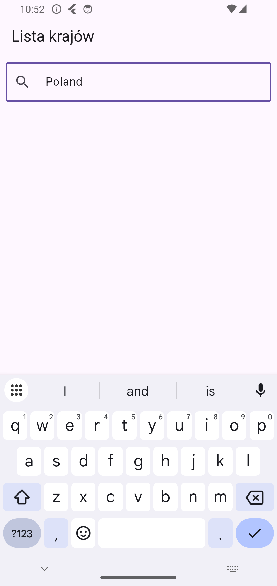

# Raporty błędów – CountriesApp

## BUG-001 – Brak wyników przy wyszukiwaniu kraju ze spacjami

**Powiązany test:** TC-009  
**Typ:** Potencjalny błąd funkcjonalny  
**Status:** Do weryfikacji wymagań  
**Ważność:** Niska (wstępna)  
**Środowisko:** Pixel 4, Android API 34

### Opis problemu
Wyszukiwarka nie znajduje kraju, gdy
użytkownik wpisze dodatkową spację przed
nazwą kraju lub po niej.

### Warunki wstępne
- Aplikacja CountriesApp jest uruchomiona.
- Lista krajów została załadowana.

### Kroki odtworzenia
1. Otwórz aplikację CountriesApp.
2. Kliknij pole wyszukiwania.
3. Wpisz ` Poland `.
4. Sprawdź wyświetlone wyniki.

### Oczekiwany rezultat
Aplikacja ignoruje zbędne spacje i
wyświetla kraj Poland.

### Rzeczywisty rezultat
Lista wyników pozostaje pusta.

### Dodatkowe testy
- `Poland` – znaleziono kraj.
- ` Poland` – brak wyników.
- `Poland ` – brak wyników.
- ` Poland ` – brak wyników.

### Uwagi
Problem można odtworzyć dla różnych
wariantów dodatkowych spacji.

Zachowanie wymaga potwierdzenia
w specyfikacji aplikacji.

### Dowód testowy

